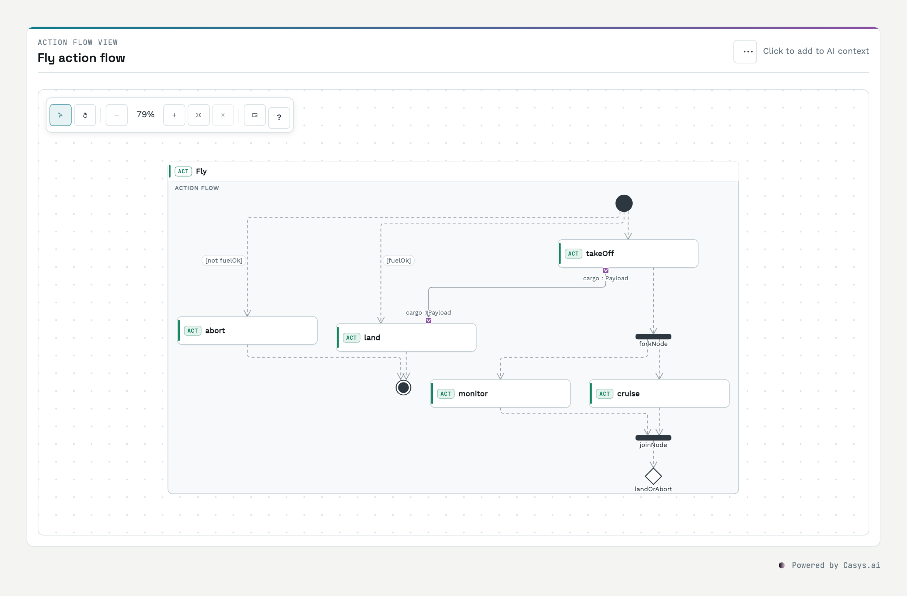
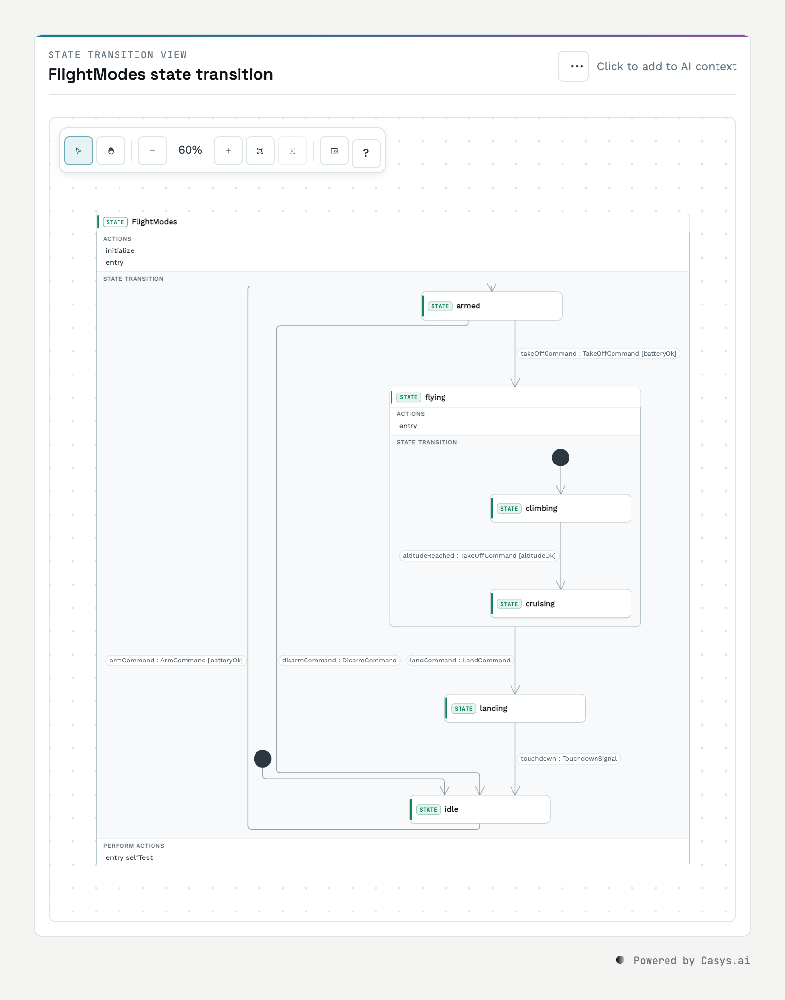
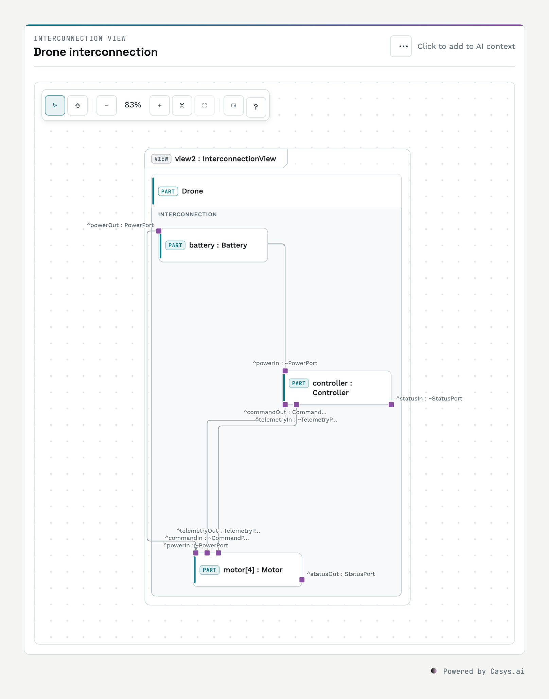
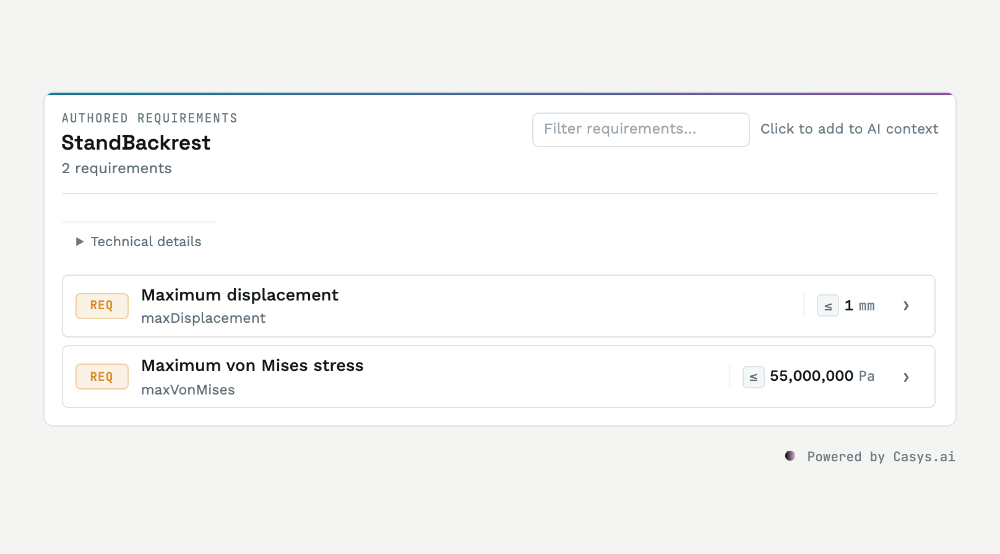

# @casys/mcp-syson

[](https://github.com/superWorldSavior/mcp-syson/actions/workflows/publish.yml)
[](https://jsr.io/@casys/mcp-syson)
[](LICENSE)

A focused [Model Context Protocol](https://modelcontextprotocol.io) provider for
[SysON](https://mbse-syson.org) and SysML v2. An MCP client works with a real
SysON model through explicit modelling, navigation, diagram, requirement,
constraint and value operations, and shows the results in interactive MCP Apps.

<picture>
  <source media="(prefers-color-scheme: dark)" srcset="docs/images/mcp-syson-action-flow-dark.png">
  
</picture>

## Viewers

Every result comes with a compact MCP App that does one job, so a host can
compose them without embedding a modelling tool.

<table>
  <tr>
    <td width="50%">
<picture>
  <source media="(prefers-color-scheme: dark)" srcset="docs/images/mcp-syson-state-transition-dark.png">
  
</picture>
    </td>
    <td width="50%">
<picture>
  <source media="(prefers-color-scheme: dark)" srcset="docs/images/mcp-syson-interconnection-dark.png">
  
</picture>
    </td>
  </tr>
</table>

- **Diagram**: SysON's General, Interconnection, Action Flow and State
  Transition views with SysON's notation, in SysON's layout or an automatic one.
- **Model explorer**: the model as a tree, loaded branch by branch.
- **Requirements** and **requirements trace**: authored limits, and satisfaction
  coverage with its gaps.
- **Validation**: constraint diagnostics by severity.
- **Query results** and **value change**: query rows, and a value before and
  after its change.

Click an element to add it to the AI context of the next turn; double-click or
press Enter to open it. See
[Browse model elements and diagram views](docs/how-to/browse-model-views.md).

<picture>
  <source media="(prefers-color-scheme: dark)" srcset="docs/images/mcp-syson-requirements-dark.png">
  
</picture>

The images are rendered from the recorded fixtures in `docs/fixtures` by
`deno task docs:viewer-screenshot`. The same operations work in clients without
MCP Apps, and no tool calls a language model: interpretation, approval and
orchestration stay with the calling client.

## Quick start

You need Deno 2.x and a SysON instance. The included development stack starts a
reviewed SysON image and PostgreSQL locally:

```bash
docker compose up -d
export SYSON_URL=http://localhost:8180
```

Run the published package over HTTP:

```bash
deno run -A jsr:@casys/mcp-syson@0.9.1/server
```

The MCP endpoint is <http://127.0.0.1:3009/mcp>. For a client that launches one
local process, use stdio instead:

```bash
deno run -A jsr:@casys/mcp-syson@0.9.1/server --stdio
```

An existing SysON deployment works too; point `SYSON_URL` at its base URL. The
server never guesses an endpoint.

See [Getting started](docs/getting-started.md) for Docker, transport, category,
authentication and renderer configuration.

## What it helps with

- Create projects, documents, packages and explicit SysML v2 structures.
- Browse and query model elements while preserving SysON identifiers.
- Draw SysON diagrams with their notation, in SysON's layout or an automatic
  one; a local SVG (or an opt-in external renderer) serves clients without MCP
  Apps.
- Trace requirements and derive product structures from model evidence.
- Evaluate unit-aware constraints and explore bounded what-if values.
- Update model values and perform fail-closed destructive operations.

The provider does not turn an acknowledgement into proof. Critical writes need
read-back, unresolved values stay unresolved, and permanent deletion is only
reported after its postcondition is observed. The exact safety and evidence
semantics live in
[Capabilities, safety and evidence](docs/capabilities-and-safety.md).

## Documentation

- [Getting started and configuration](docs/getting-started.md)
- [Capabilities, safety and evidence](docs/capabilities-and-safety.md)
- [Browse model elements and diagram views](docs/how-to/browse-model-views.md)
- [MCP Apps and recorded viewer contracts](docs/mcp-apps.md)
- [Provider APIs, architecture and development](docs/provider-development.md)
- [Release history](CHANGELOG.md)
- [Private vulnerability reporting](SECURITY.md)

## Development

```bash
deno task check
deno task lint
deno task fmt
deno task test
```

Viewer development uses the published MCP View packages and requires a rebuild
after source changes. The complete loop is documented in
[MCP Apps and recorded viewer contracts](docs/mcp-apps.md#build-and-verify).

## License

[MIT](LICENSE)
